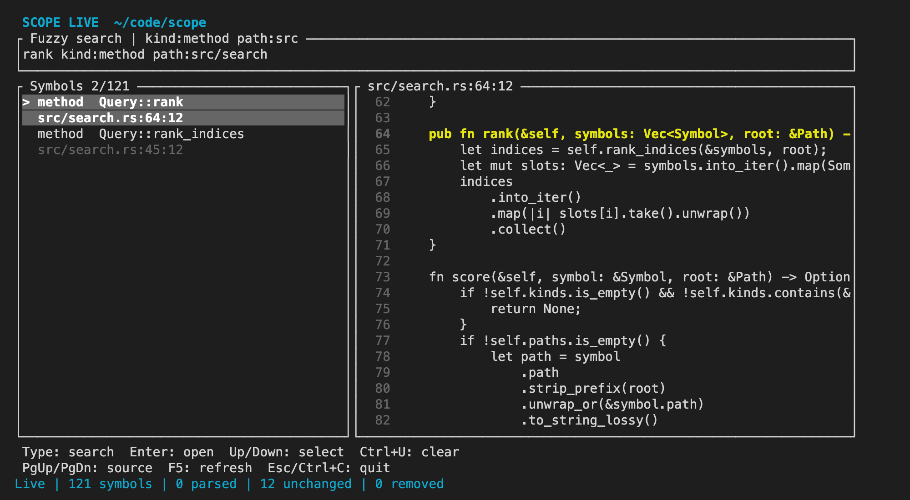
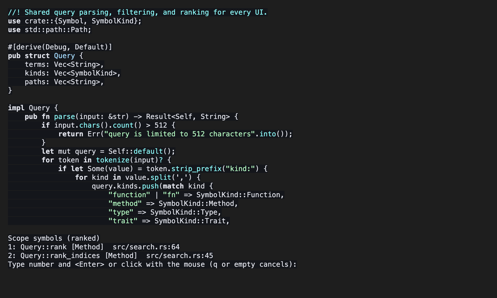

# Scope

Scope is a native code intelligence tool for Rust and Go repositories. It
parses source with Tree-sitter (not text matching), keeps a symbol index in
SQLite, and lets you search functions, methods, types, and traits from the
command line, a terminal browser, or Neovim.

## Set up on macOS

Install Apple's Command Line Tools if they are missing:

```sh
xcode-select -p || xcode-select --install
```

Install Rust using the instructions at <https://rustup.rs/>. Open a new Terminal
window afterward, then check `rustc --version` and `cargo --version`.

From this directory:

```sh
cargo test
cargo run -- scan .
cargo run -- scan /path/to/your/repository
```

To keep the binary available outside this directory:

```sh
cargo install --path .
scope scan /path/to/your/repository
```

The first build downloads dependencies and compiles the Rust and Go grammars.
The scanner respects `.gitignore`, does not follow directory symlinks, and
skips source files larger than 2 MiB. File read problems
appear as warnings. Locations are one-based; columns count UTF-8 bytes.

## Commands

| Command | What it does |
| --- | --- |
| `scope scan [PATH]` | Parse files and print symbols with locations. |
| `scope index [PATH]` | Update the saved index, reparsing only changed files. |
| `scope find QUERY` | Search the saved index without rescanning. |
| `scope browse [PATH]` | Search interactively with a source preview. |
| `scope open [QUERY] [PATH]` | Refresh symbols and open a match in your editor. |
| `scope watch [PATH]` | Keep the index updated as files change. |
| `scope lsp [PATH]` | Serve workspace symbol search over LSP. |

Query syntax (`kind:`, `path:`, ranking) is documented in [SEARCH.md](SEARCH.md).
Omit `PATH` to use the nearest Git root or the current directory.

## Finding your way around

Index once, then search from the shell:

```sh
scope index
scope find 'rank kind:method path:src/search'
```

```text
/path/to/repo/src/search.rs:64:12	method	Query::rank
/path/to/repo/src/search.rs:45:12	method	Query::rank_indices
found 2 symbols
```

Each result is `path:line:column`, so most terminals and editors can jump to it.

Open the interactive browser and type to filter. The right pane previews the
source around the selected symbol.



| Key | Action |
| --- | --- |
| Type | Filter symbols. Accepts `kind:` and `path:` filters. |
| Up / Down | Move the selection. |
| PgUp / PgDn | Scroll the source preview. |
| Enter | Open the selected symbol in your editor at its line and column. |
| Ctrl+U | Clear the query. |
| F5 | Re-index now. |
| Esc / Ctrl+C | Quit. |

Skip the browser when you know the name. `scope open` refreshes the index and
jumps straight to the match when there is exactly one. With several matches it
opens the browser, and with none it exits with an error:

```sh
scope open Query::parse
scope open 'tokenize kind:fn'
```

The editor comes from `$VISUAL`, then `$EDITOR`, then `nvim`. Neovim and Vim
open with the cursor on the symbol.

In Neovim, `:ScopeSymbols rank kind:method` opens the same search in Neovim's `vim.ui.select` picker.
Type a number and press Enter to jump to that symbol.


Workspace symbol search also works through any LSP client that runs `scope lsp`.

## Neovim

`contrib/scope.lua` starts the LSP server for Rust and Go buffers and adds
`:ScopeSymbols`. It runs `scope` from your `PATH`. Set `vim.g.scope_binary` to
use another binary. Requires Neovim 0.11+.

## Design

`src/lib.rs` contains the scanner and owned `Symbol` records. The syntax tree
borrows from a source buffer while parsing; the returned symbols own their
names and paths so they remain valid after that buffer is dropped. `src/index.rs`
maintains content hashes and symbols in SQLite. `src/search.rs` parses and ranks
queries. `src/browse.rs`, `src/lsp.rs`, `src/watch.rs`, and `src/live.rs` provide
the terminal browser, language server, file watcher, and open-buffer overlay.
`src/main.rs` handles the command line interface.

## License

MIT. See [LICENSE](LICENSE).
